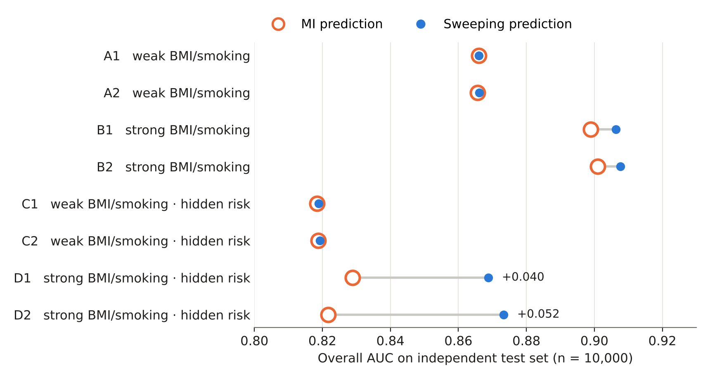
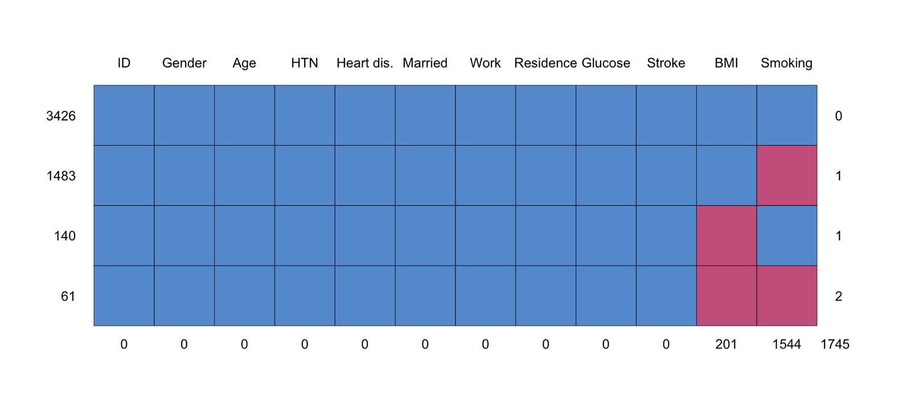
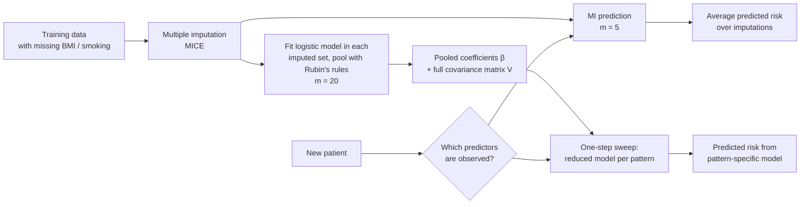
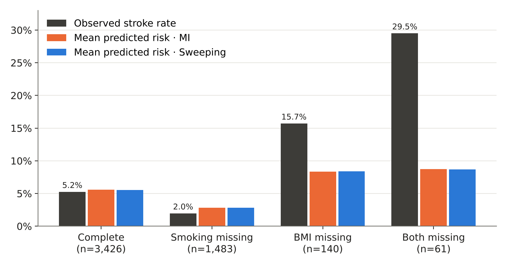
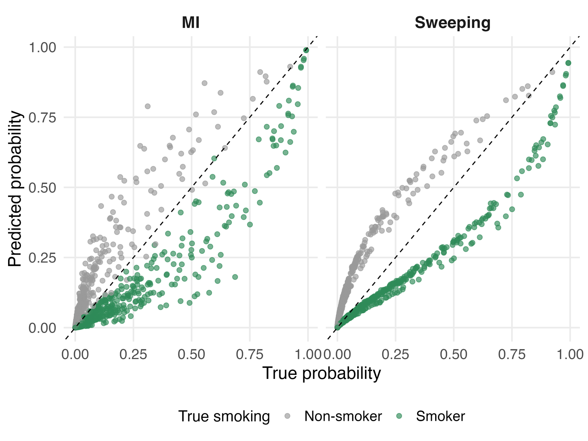
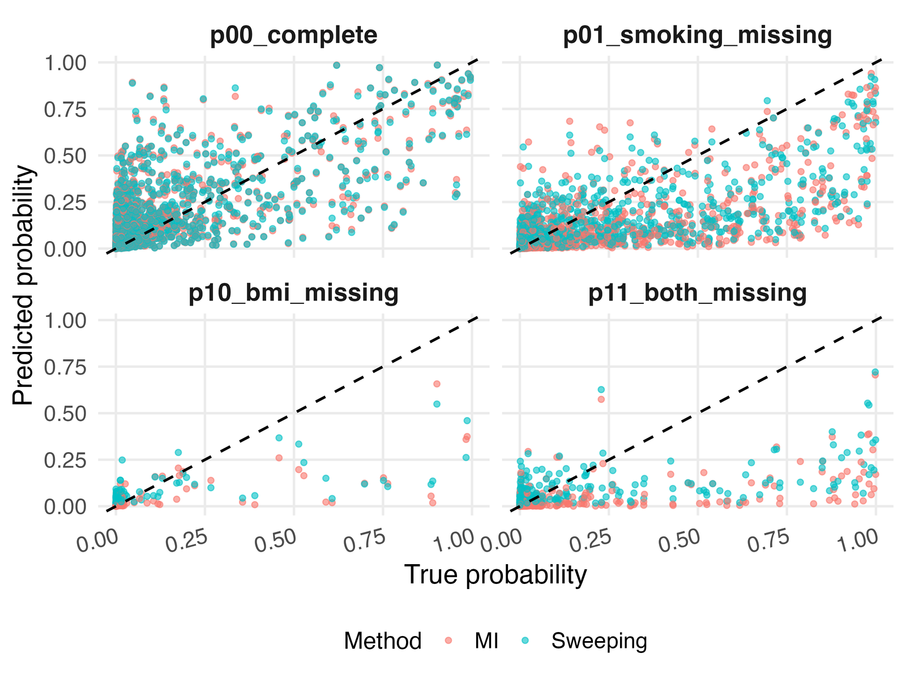

# Predicting Patient Risk When Data Is Missing: Sweeping vs Multiple Imputation


> **MSc thesis project** · Statistics and Data Science, Leiden University (2026)
> Supervised by Dr. Bart J. A. Mertens, Department of Biomedical Data Sciences, Leiden University Medical Center

A clinical risk model is built on complete data, but the next patient walks in **without a BMI measurement or a known smoking history**. What should the model do?

This project compares two answers to that question on a real stroke dataset (5,110 patients) and in a simulation study with 8 controlled scenarios:

| Approach | How it handles a missing predictor at prediction time | Cost per new patient |
|---|---|---|
| **MI prediction** | Re-imputes the missing values many times with the original training data, then averages the predictions | Heavy: needs the training data and repeated imputation |
| **Sweeping prediction** | Algebraically derives a smaller model that only uses the predictors this patient has (one-step sweep operator) | Light: one matrix formula, no imputation |

---

## Key findings

1. **On the real stroke data the two methods are practically identical** — AUC 0.839 vs 0.839, Brier 0.0424 vs 0.0424 — while sweeping avoids imputation at prediction time.
2. **They diverge only when the missing predictors are strong *and* there is hidden risk.** In the hardest scenarios sweeping had *higher* AUC (+0.040 and +0.052).
3. **Missingness itself can signal risk.** Patients missing both BMI and smoking had a **29.5%** stroke rate, yet both models predicted under 9%. No method can recover information the model never sees — the choice of method matters less than which predictors are available.

<p align="center">
  
</p>

---

## The problem in one picture

In the stroke data, a third of patients lack BMI and/or smoking status, giving four **missing-data patterns**:

<p align="center">
  
</p>

| Pattern | BMI | Smoking | Patients | Share |
|---|---|---|---:|---:|
| p00 Complete | observed | observed | 3,426 | 67.1% |
| p01 Smoking missing | observed | missing | 1,483 | 29.0% |
| p10 BMI missing | missing | observed | 140 | 2.7% |
| p11 Both missing | missing | missing | 61 | 1.2% |

Every new patient falls into one of these patterns, so performance is evaluated **overall and within each pattern** — averages can hide a pattern where the model fails.

---

## Approach



**Sweeping in one formula.** Split the pooled coefficients into observed ($O$) and missing ($M$) predictors. The reduced model for a patient missing $M$ is

$$
\boldsymbol\beta_{\text{red}} = \boldsymbol\beta_O - V_{OM}\,V_{MM}^{-1}\,\boldsymbol\beta_M,
\qquad
\hat p_i = \operatorname{expit}\!\left(\mathbf x_{i,O}^\top \boldsymbol\beta_{\text{red}}\right)
$$

The correction term $V_{OM}V_{MM}^{-1}\boldsymbol\beta_M$ shifts the remaining coefficients to absorb what the missing predictor would have contributed (Marshall et al., 2002). Implemented from scratch in [`R/02_real_data_analysis.R`](R/02_real_data_analysis.R) (`derive_reduced_model()`).

**Evaluation**

- Real data: **10-fold cross-validation**; standardisation, imputation and model fitting use the training folds only, and held-out outcomes are never used for imputation (no leakage).
- Simulation: independent calibration (n = 5,110) and test (n = 10,000) sets generated from parameters estimated on the real data. Because each simulated patient's **true risk is known**, predictions are compared with the truth, not only with 0/1 outcomes.
- Metrics: Brier score, AUC, calibration (observed vs predicted by risk decile and by pattern), mean prediction bias, correlation with true risk.

---

## Results

### 1. Real stroke data (10-fold CV)

| Method | N predicted | Brier ↓ | AUC ↑ |
|---|---:|---:|---:|
| MI prediction | 5,110 | 0.0424 | 0.8390 |
| Sweeping prediction | 5,110 | 0.0424 | 0.8389 |

A complete-case model, by comparison, can only predict for the 67% of patients with no missing values.

Within patterns, the two methods still agree (largest AUC gap 0.005), but the patterns themselves differ sharply in risk:

<p align="center">
  
</p>

| Pattern | N | Brier MI | Brier Sweeping | AUC MI | AUC Sweeping |
|---|---:|---:|---:|---:|---:|
| p00 Complete | 3,426 | 0.0457 | 0.0457 | 0.8217 | 0.8216 |
| p01 Smoking missing | 1,483 | 0.0185 | 0.0186 | 0.8754 | 0.8741 |
| p10 BMI missing | 140 | 0.1320 | 0.1315 | 0.7192 | 0.7200 |
| p11 Both missing | 61 | 0.2324 | 0.2319 | 0.7429 | 0.7481 |

**Why so similar?** In the pooled model BMI (OR 1.02) and smoking (OR 1.25) carry little predictive information compared with age (OR 5.38 per SD), so losing them changes little — exactly what the weak-predictor simulation scenarios (A, C) reproduce.

### 2. Simulation study (2 × 2 × 2 design)

| Factor | Levels |
|---|---|
| Strength of BMI and smoking effects | weak (β = 0.01) · strong (β = 2.0) |
| Hidden variable *W* affects stroke risk | no · yes |
| Smoking missingness also depends on *W* | no (“1”) · yes (“2”) |

*W* is never available to either model; it represents unmeasured information (e.g. frailty) that drives both missingness and risk.

| Scenario | BMI/smoking | Hidden risk | Brier MI | Brier Sweeping | AUC MI | AUC Sweeping |
|---|---|---|---:|---:|---:|---:|
| A1 | weak | no | 0.0396 | 0.0396 | 0.8660 | 0.8660 |
| A2 | weak | no | 0.0396 | 0.0396 | 0.8657 | 0.8661 |
| B1 | strong | no | 0.0353 | 0.0350 | 0.8989 | 0.9063 |
| B2 | strong | no | 0.0350 | 0.0347 | 0.9010 | 0.9077 |
| C1 | weak | yes | 0.0424 | 0.0424 | 0.8184 | 0.8189 |
| C2 | weak | yes | 0.0425 | 0.0424 | 0.8188 | 0.8193 |
| D1 | strong | yes | 0.0402 | **0.0390** | 0.8289 | **0.8688** |
| D2 | strong | yes | 0.0403 | **0.0390** | 0.8217 | **0.8733** |

**Diagnosing *why* performance drops** (pattern-level analysis using the known true risk):

<table>
<tr>
<td width="50%"></td>
<td width="50%"></td>
</tr>
<tr>
<td><b>Loss of information (B2).</b> When smoking is missing, smokers (true risk 8.8%) and non-smokers (2.4%) receive almost the same prediction — the 6.4-point gap shrinks to about 1 point. Both methods compress risk toward the average.</td>
<td><b>Hidden high-risk subgroup (D2).</b> Patients missing both predictors have a mean true risk of 16.7% vs 2.8% for complete cases. Both methods under-predict; sweeping less so (mean prediction 8.2% vs 4.4%, AUC 0.808 vs 0.800).</td>
</tr>
</table>

All per-pattern simulation results are in [`results/thesis_simulation_by_pattern.csv`](results/thesis_simulation_by_pattern.csv); figures for every scenario are in [`figures/thesis/`](figures/thesis/).

### Takeaways for practice

- If the missing predictors are weak, **sweeping is a drop-in, much cheaper alternative** to MI prediction at the point of care.
- Report performance **per missing-data pattern**: an acceptable overall AUC can hide a subgroup where predicted risk is a third of the observed risk.
- When missingness is tied to unmeasured risk factors, **no handling method fixes it** — the remedy is collecting the information, or modelling missingness explicitly.

---

## Skills demonstrated

| Area | In this project |
|---|---|
| Statistical modelling | Logistic regression, likelihood-ratio and D1 omnibus tests, Rubin's rules, covariance-matrix algebra |
| Missing data | Missingness-mechanism exploration (MCAR/MAR/MNAR), MICE (PMM, logistic, polytomous imputation), complete-case vs MI bias check, sensitivity analysis |
| Prediction & validation | 10-fold cross-validation without leakage, Brier score, AUC, calibration plots, subgroup (pattern) evaluation |
| Simulation | Data-based Monte Carlo design, factorial scenarios, intercept calibration by root-finding, controlled missingness mechanisms |
| Algorithm implementation | One-step sweep operator and pooled-covariance pooling written from scratch in base R |
| R engineering | `mice`, `mipred`, `pROC`, `dplyr`, `tidyr`, `ggplot2`; reusable functions, fixed seeds, reproducible scripts |
| Communication | Translating diagnostic results into recommendations for clinical model deployment |

---

## Repository structure

```
sweeping-vs-imputation/
├── R/
│   ├── 00_setup.R                 # packages + paths
│   ├── 01_data_exploration.R      # missingness patterns & mechanisms, CC vs MI, simulation parameters
│   ├── 02_real_data_analysis.R    # 10-fold CV: complete case vs MI prediction vs sweeping
│   └── 03_simulation_study.R      # 8-scenario simulation + diagnostics
├── data/
│   └── README.md                  # where to download the Kaggle CSV
├── figures/
│   ├── summary_*.png              # summary charts used in this README
│   └── thesis/                    # figures from the thesis
├── results/
│   └── thesis_*.csv               # result tables reported in the thesis
├── sweeping-vs-imputation.Rproj
└── LICENSE
```

## How to reproduce

1. Download `healthcare-dataset-stroke-data.csv` from [Kaggle](https://www.kaggle.com/datasets/fedesoriano/stroke-prediction-dataset) into `data/`.
2. Open `sweeping-vs-imputation.Rproj` in RStudio (or set the working directory to the repository root).
3. Run the scripts in order:

```r
source("R/01_data_exploration.R")    # ~ minutes
source("R/02_real_data_analysis.R")  # 10-fold CV, longer
source("R/03_simulation_study.R")    # all 8 scenarios, longest; set RUN_ALL_SCENARIOS <- FALSE to run one
```

Outputs are written to `results/` and `figures/`. Seeds are fixed (`set.seed(123)`); exact decimals can differ slightly across package versions.

---

## References

- Marshall, G., Warner, B., MaWhinney, S., & Hammermeister, K. (2002). Prospective prediction in the presence of missing data. *Statistics in Medicine*, 21(4), 561–570.
- Mertens, B. J. A., Banzato, E., & de Wreede, L. C. (2020). Construction and assessment of prediction rules for binary outcome in the presence of missing predictor data using multiple imputation and cross-validation. *Biometrical Journal*, 62(3), 724–741.
- van Buuren, S. (2018). *Flexible Imputation of Missing Data* (2nd ed.). CRC Press.
- Steyerberg, E. W. (2019). *Clinical Prediction Models* (2nd ed.). Springer.

## Author

**Yu-Chen Huang** — MSc Statistics and Data Science, Leiden University
[LinkedIn](https://www.linkedin.com/in/your-profile) · Open to data science and biostatistics roles in the Netherlands
